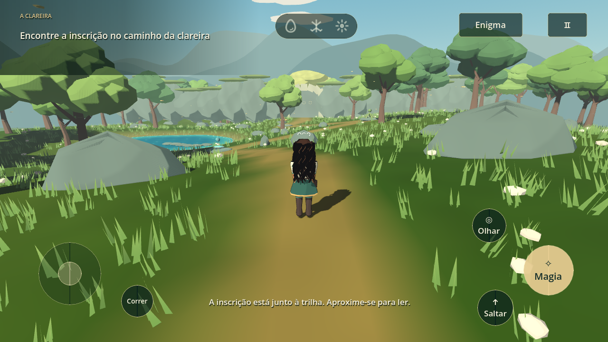

# Asterion — O despertar



Uma aventura de bruxa em **3D, terceira pessoa, para Android**, feita com **Godot 4.6.3 / GDScript**. A direção atual combina personagem de estudo anime, iluminação em faixas e **exploração por regiões, enigma ambiental e progressão guiada**, conforme a referência de estrutura de Ocarina of Time escolhida pelo autor. Os modelos, cenário, interface e áudio são próprios; não há assets de Zelda.

## Primeira região jogável — versão 0.2.0

Asterion inicia numa trilha elevada que leva à clareira. Uma inscrição descreve a relação entre três sinais naturais. O jogador precisa observar, explorar e experimentar a magia para abrir a passagem até a área seguinte.

- Personagem construída com superfícies modeladas, rosto anime, olhos âmbar, cachos castanho-escuros longos, roupa articulada e animação de caminhada, corrida, salto e magia.
- Terreno com relevo e colisão correspondente, trilhas, vegetação ao vento, lago, céu, árvores e passagem de pedra.
- Enigma de sequência **Água → Raiz → Luz**, com respostas distintas, reinício em caso de erro e abertura física da passagem.
- Exploração posterior até a árvore além da passagem; resolver o enigma não conclui automaticamente a região.
- Câmera com colisão, foco contextual, corrida com energia e salto com tolerância nas bordas.
- Controles simultâneos para toque, pausa e leitura; botão Voltar do Android e perda de foco tratados.
- Menu sobre o cenário real, prólogo opcional, indicador dos sinais e interface em português.
- Ambiente musical original e respostas sonoras das interações.

**Limites desta versão:** trata-se de uma primeira região experimental. Não há combate, inventário, NPCs, múltiplas missões ou outras regiões completas. O registro local guarda a conclusão, mas ainda não existe continuar/salvamento completo. O desempenho e a ergonomia precisam de testes num aparelho Android físico.

A aparência e a roupa ainda são um estudo visual, não a arte final aprovada. A referência da roupa não foi disponibilizada. Os elementos do enigma e a disposição dos espaços são propostas de gameplay; não acrescentam explicações definitivas à cosmologia. Veja [continuidade](docs/CONTINUIDADE.md).

## Abrir e jogar

Abra `project.godot` no Godot **4.6.3** e execute com **F5**.

```sh
cd /workspace/witchs-magical-path
godot --editor --path .
# Ou iniciar diretamente num ambiente com tela:
godot --path .
```

Em ambientes restritos, defina diretórios graváveis antes dos comandos:

```sh
export XDG_DATA_HOME=/workspace/.local/share
export XDG_CONFIG_HOME=/workspace/.config
export XDG_CACHE_HOME=/workspace/.cache
```

| Ação | Android | Computador |
| --- | --- | --- |
| Caminhar | Controle à esquerda | WASD / setas |
| Olhar | Arrastar à direita | Arrastar o mouse |
| Magia / ler inscrição | Botão Magia / Ler | E |
| Saltar | Saltar | Espaço |
| Correr | Segurar Correr + caminhar | Segurar Shift |
| Focar sinal / centralizar câmera | Olhar | Q ou F |
| Pausar | Botão superior / Voltar | Esc |

A inscrição está na trilha de entrada. O botão **Enigma** permite reler a pista. Os três sinais da clareira precisam responder na ordem sugerida. Depois de abrir a passagem, siga em frente para alcançar a área seguinte.

## Android

[Preparação, exportação e instalação](docs/ANDROID.md).

```sh
./tools/setup_android.sh
./tools/export_android.sh
```

O APK de desenvolvimento fica em `build/asterion-debug.apk`, assinado para testes, compatível com Android 7.0+ ARM64 e OpenGL ES 3.0. Não é uma publicação de loja.

## Validação

```sh
godot --headless --editor --path . --import --quit
godot --headless --path . --script res://tests/smoke_test.gd
godot --headless --path . --script res://tests/traversal_smoke.gd
godot --headless --path . --script res://tests/ui_smoke.gd
```

O teste integrado executa a cena, o terreno, a inscrição, a sequência correta/incorreta, o bloqueio físico da passagem e sua travessia, a conclusão e o reinício. O teste de movimento cobre câmera, salto, energia e pausa. O teste de interface despacha toques nativos simultâneos.

Capturas renderizadas ficam em `build/` e não são versionadas. Validar o pacote e renderizar no computador não substitui executar num celular real.

## Organização

```text
scenes/main.tscn              Cena inicial
scripts/main.gd               Região, enigma e transições
scripts/player.gd             Movimento, salto, corrida e câmera
scripts/character_visual.gd   Malhas e animação da personagem
scripts/forest.gd             Terreno, cenário, sinais e passagem
scripts/game_ui.gd            Menu e controles
shaders/                     Materiais do personagem, terreno, água e vegetação
assets/                      Ícone, fonte licenciada e áudio original
tests/                       Testes executáveis no Godot
tools/                       Preparação e exportação Android
```
