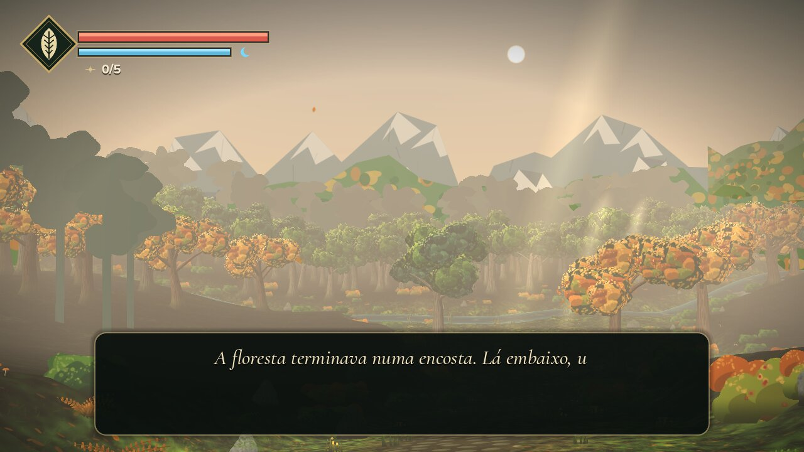
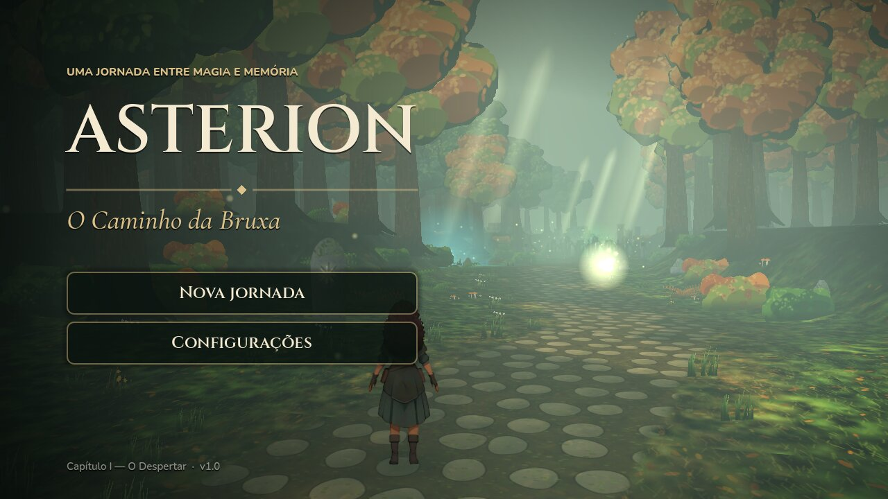
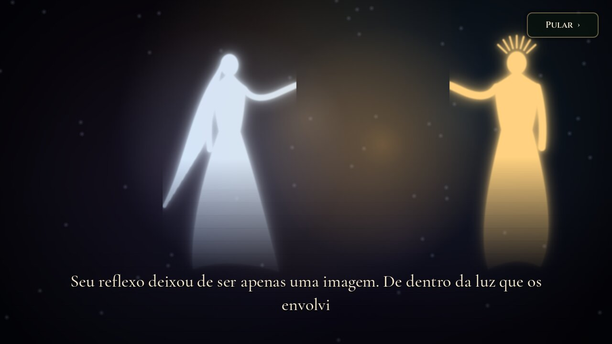
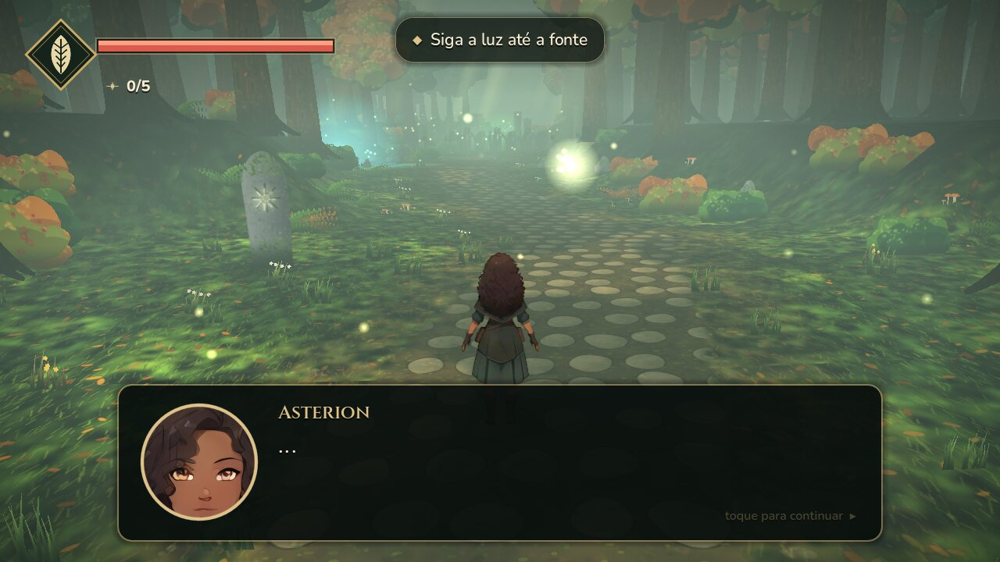
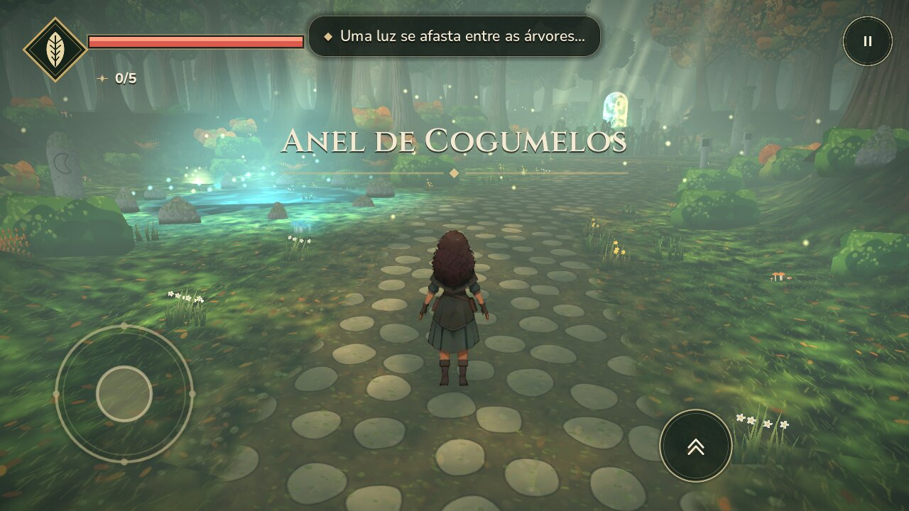
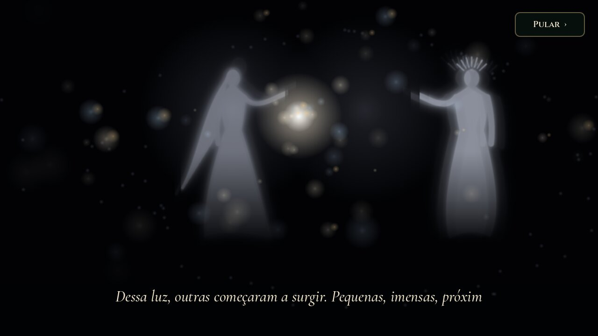
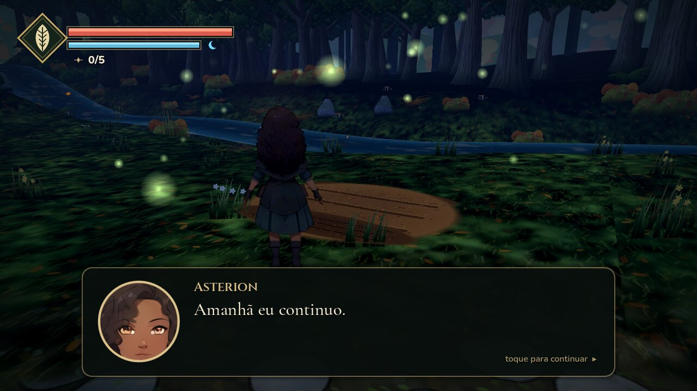

# Asterion — O Caminho da Bruxa



Aventura de bruxa para **Android** (Godot 4.6.3 / GDScript) em estilo "HD‑2D" pintado:
um mundo 3D enevoado de floresta outonal, com árvores, ruínas e efeitos pintados à mão por
código, e a protagonista **Asterion** desenhada exatamente como na ficha de personagem.

| Título | Prólogo | Diálogo |
| --- | --- | --- |
|  |  |  |
|  |  |  |

## O que há no jogo (v1.2)

- **Prólogo — O nascimento dos primeiros Deuses**: o texto completo do autor, cartão a cartão,
  sobre cenas animadas. Tocar avança; "Pular" disponível.
- **Capítulo I — O Despertar** (Bosque do Despertar): um aprendizado em cadeia, sem legendas
  explicando cada ação — o jogador descobre junto com Asterion:
  1. a floresta responde à presença dela (cogumelos que acendem, o **Anel de Cogumelos**);
  2. a **Fonte da Lua** desperta a luz em suas mãos;
  3. as **lanternas** frias se agitam quando ela se aproxima — a luz as reacende e as raízes recuam;
  4. nas **Ruínas**, as Sombras recuam da luz; uma centelha espera atrás de um tronco (pule!);
  5. a **Chama Eterna** traz a segunda força (troca **Lua ↔ Chama**);
  6. no **Santuário**, cada altar brilha na cor da força que espera; os dois precisam despertar
     **juntos** (“Nenhum existia acima do outro”) e o portal se abre.
- **A lembrança — Uma saudade sem rosto**: ao atravessar o arco, um fragmento breve e incompleto
  da história primordial — duas presenças que se desfazem quando observadas, a luz entre elas,
  águas profundas, uma silhueta entre estrelas. Asterion sente saudade sem reconhecer ninguém.
- **Capítulo II — Um lugar para ficar** (Vale do Rio): do alto da encosta, a primeira visão do
  continente — rio, colinas, montanhas e névoa. A missão:
  1. encontrar a clareira (água perto, chão firme, luz);
  2. recolher galhos e montar um abrigo simples;
  3. observar a planta, recolher sementes, preparar a terra e semear;
  4. regar: ao tocar o rio, a água acompanha o gesto da mão — e ela repete, com cuidado;
  5. a primeira noite, à entrada do abrigo: “— Amanhã eu continuo.”
- **Mapa do Primeiro Continente** (Pausa → Mapa), com a posição de Asterion. Nomes provisórios.
- **5 centelhas** escondidas, diálogos com retrato, salvamento automático e checkpoints.
- **Floresta sólida**: troncos 3D com raízes, galhos e casca, coroados por copas pintadas — as
  árvores mantêm forma e proporção de qualquer ângulo e de perto.
- **Movimento natural**: aceleração suave, curvas sem trancos, transição suave entre vistas,
  12 quadros de caminhada com cabelo e saia acompanhando o corpo, e pequenas pausas em que ela
  se vira para observar algo próximo.
- **Viva quando parada**: ela olha em volta, encara as Sombras próximas, repara nas centelhas,
  suspira, sente o vento levantar cabelo e capa (com folhas passando), troca o peso do corpo,
  brinca com a luz nas mãos e, depois de uma longa pausa, se abaixa para tocar a terra.
  Depois de correr muito, para e recupera o fôlego.
- **Andar e correr naturais**: joystick analógico (o quanto se inclina define o passo), balanço
  do quadril sobre o pé de apoio, braços acompanhando as pernas, inclinação nas curvas da
  corrida, amortecimento ao aterrissar e poeira nos pés.
- **Botão Correr** (»): liga/desliga e se desliga sozinho quando ela para (Shift no teclado).
- **Retrato vivo nos diálogos**: respira, pisca, balança enquanto fala, inclina a cabeça em
  perguntas e se sobressalta em exclamações; moldura dourada com lua e folha.
- **Novo ícone** do aplicativo (adaptativo, com versão monocromática para ícones temáticos).
- Controles de toque multitoque, teclado e controle; Voltar do Android pausa.
- Trilha sonora e efeitos originais (CC0). Configurações de som, câmera e gráficos.

## Controles no computador

| Ação | Tecla |
| --- | --- |
| Andar / correr | WASD ou setas / segurar Shift |
| Câmera | botão direito do mouse + arrastar, Q / C |
| Magia | E ou J |
| Pular | Espaço |
| Interagir / ler | F ou Enter |
| Trocar essência | Tab ou R |
| Pausa | Esc |

## A personagem

Asterion vem diretamente da ficha enviada (`tools/art/ai/reference_sheet.jpg`):

1. Cada vista (frente, perfil, costas, busto ¾) é recortada da ficha;
2. ampliada 4× com **Real‑ESRGAN x4plus_anime** (rede neural de super‑resolução para anime,
   executada em numpy — `tools/art/ai/esrgan_numpy.py`);
3. o fundo é removido com **ISNet‑anime** (segmentação por IA) e refinado/desfeito o halo;
4. as animações (respirar, andar, correr, magia, pulo, levantar, dano) são feitas deformando
   regiões da própria pintura — pernas, cabelo, saia, capa e braço — em
   `tools/art/ai/build_witch_sprites.py`. Assim ela permanece idêntica à arte de referência.

No jogo ela é um sprite com *billboard* em um mundo 3D, com shader próprio (sem névoa, leve
contorno de luz) e 8 direções (frente, perfil espelhado e costas).

## Abrir, testar e exportar

```bash
godot --editor --path .
```

```bash
godot --headless --path . --script res://tests/compile_all.gd
```

```bash
godot --headless --path . --script res://tests/story_smoke.gd
```

```bash
godot --headless --path . --script res://tests/motion_smoke.gd
```

O `story_smoke` joga os dois capítulos pelos sistemas reais: andar, pular o tronco, magia,
lanternas, sombras, centelha, essências, altares, portal, lembrança, chegada ao vale, galhos,
abrigo, sementes, plantio, rega e a primeira noite. `tests/tour.gd` e `tests/tour2.gd` geram
capturas (precisam de tela/xvfb).

### Android

```bash
./tools/setup_android.sh
```

```bash
./tools/export_android.sh
```

Gera `build/asterion.apk` (assinatura de depuração, Android 7.0+, ARM64, OpenGL ES 3.0,
sem permissões). Detalhes em [docs/ANDROID.md](docs/ANDROID.md).

## Regenerar a arte e o áudio

```bash
cd tools/art && npm i --no-save playwright && node build_env.cjs
```

```bash
python3 tools/art/ai/build_witch_sprites.py
```

```bash
python3 tools/audio/generate_audio.py
```

Após gerar texturas novas, rode `python3 tools/set_texture_imports.py` e reimporte no Godot
(texturas 3D usam mipmaps e compressão de GPU ETC2/S3TC).

## Organização

```text
scenes/main.tscn                Cena inicial
scripts/main.gd                 Fluxo: título → prólogo → capítulo → fim; entrada e pausa
scripts/autoload/               Game (estado, salvamento, configurações) e Audio
scripts/world/                  Base comum, Capítulo I (world.gd), Vale do Rio (valley_world.gd),
                                terreno, floresta 3D (forest.gd) e interações
scripts/actors/                 Asterion, câmera, magia, Sombras e o Lume
scripts/ui/                     HUD, toque, diálogos, menus, mapa, prólogo e lembrança
shaders/                        Sprites com vento, chão pintado, água, véu, raios de luz, personagem
assets/                         Sprites, texturas, fontes (OFL) e áudio (CC0)
tools/art/                      Geradores de arte (Chromium/canvas) e pipeline de IA da personagem
tools/audio/                    Síntese da trilha e dos efeitos
tests/                          Testes automatizados
```
