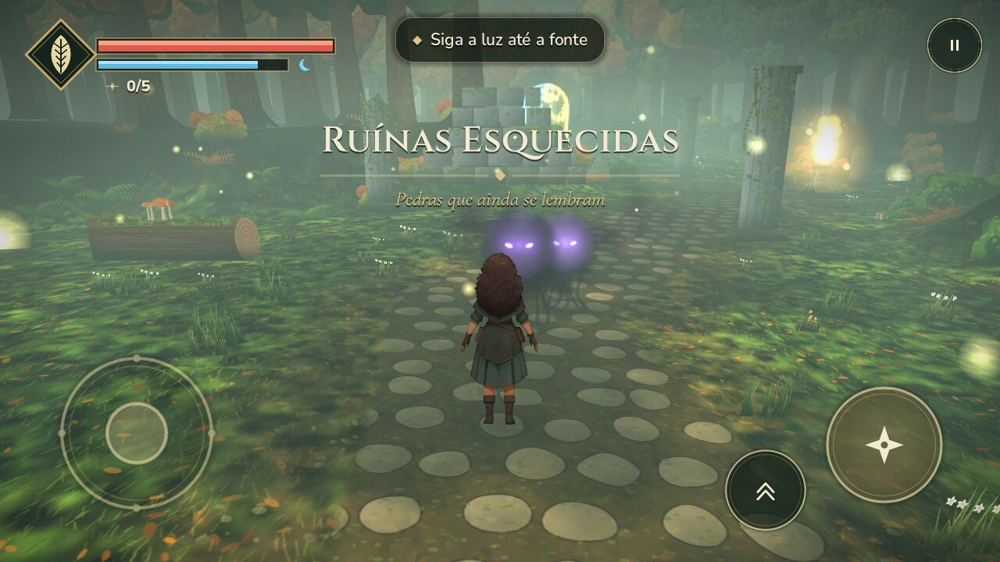
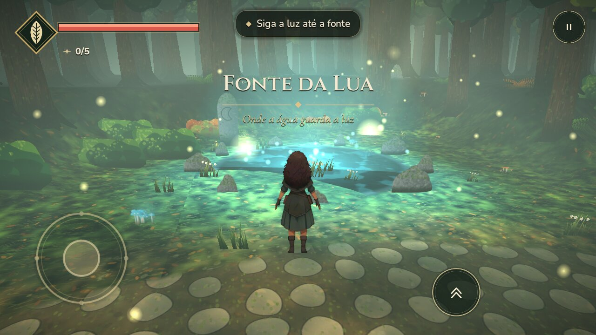
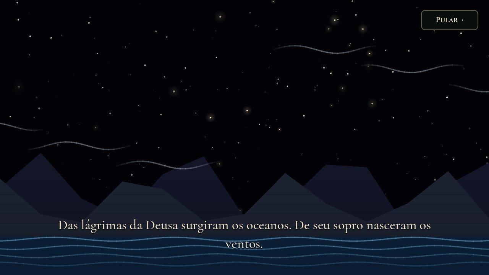
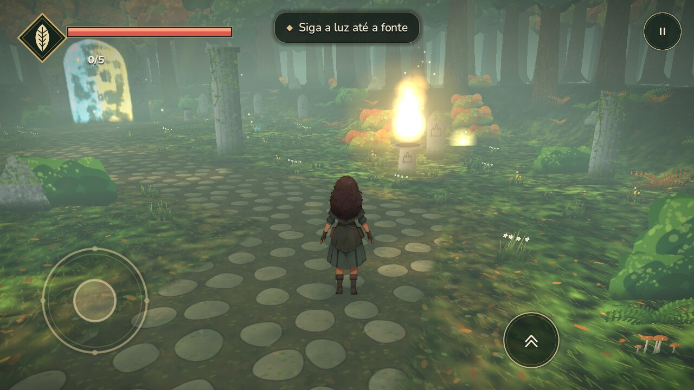

# Asterion — O Caminho da Bruxa



Aventura de bruxa para **Android** (Godot 4.6.3 / GDScript) em estilo "HD‑2D" pintado:
um mundo 3D enevoado de floresta outonal, com árvores, ruínas e efeitos pintados à mão por
código, e a protagonista **Asterion** desenhada exatamente como na ficha de personagem.

| Título | Prólogo | Diálogo |
| --- | --- | --- |
|  |  |  |
|  |  |  |

## O que há no jogo (v1.0)

- **Prólogo — O nascimento dos primeiros Deuses**: o texto completo do autor, cartão a cartão,
  sobre cenas animadas (o Infinito, a Deusa, o reflexo, o nascimento do Deus, a criação dos
  oceanos, ventos, montanhas e estrelas, a magia nas raízes e nas chamas, as primeiras bruxas).
  Tocar avança; "Pular" disponível.
- **Capítulo I — O Despertar** (~15–25 min): Asterion desperta na Clareira e segue o *Lume*
  (luz-guia) por cinco áreas:
  1. **Clareira do Despertar** — pedra com inscrição, primeira centelha escondida.
  2. **Fonte da Lua** — ao tocar a água, Asterion descobre a magia (essência da Lua).
  3. **Trilha das Lanternas** — acender três lanternas de pedra com magia recolhe as raízes.
  4. **Ruínas Esquecidas** — primeiro encontro com as **Sombras**; centelha atrás de um tronco (pule!).
  5. **Chama Eterna** — ganha a essência da Chama e a troca **Lua ↔ Chama**.
  6. **Santuário dos Primeiros** — emboscada de sombras e o enigma final: os altares da Lua e da
     Chama precisam despertar **juntos** (“Nenhum existia acima do outro”), abrindo o portal.
- **5 centelhas** escondidas (cada uma aumenta a mana e revela um verso do prólogo).
- Vida e mana com o emblema de folha, objetivo no topo, títulos de área, diálogos com retrato,
  checkpoints com salvamento automático, morte e renascimento, tela de fim de capítulo com estatísticas.
- **Controles de toque multitoque**: joystick flutuante (empurre até o fim para correr),
  arrastar à direita para girar a câmera, botões Magia ✦, Pular, Interagir (aparece perto de objetos),
  Essência e Pausa. Botão Voltar do Android pausa. Também funciona com teclado e controle.
- Trilha sonora, ambiente e efeitos originais sintetizados (CC0).
- Configurações: volume de música/efeitos, sensibilidade da câmera, gráficos *Bonito/Leve*.

## Controles no computador

| Ação | Tecla |
| --- | --- |
| Andar / correr | WASD ou setas / segurar Shift |
| Câmera | botão direito do mouse + arrastar, Q / C |
| Magia | E ou J |
| Pular | Espaço |
| Interagir / ler | F ou Enter |
| Trocar essência | Tab ou R |
| Pausa | Esc |

## A personagem

Asterion vem diretamente da ficha enviada (`tools/art/ai/reference_sheet.jpg`):

1. Cada vista (frente, perfil, costas, busto ¾) é recortada da ficha;
2. ampliada 4× com **Real‑ESRGAN x4plus_anime** (rede neural de super‑resolução para anime,
   executada em numpy — `tools/art/ai/esrgan_numpy.py`);
3. o fundo é removido com **ISNet‑anime** (segmentação por IA) e refinado/desfeito o halo;
4. as animações (respirar, andar, correr, magia, pulo, levantar, dano) são feitas deformando
   regiões da própria pintura — pernas, cabelo, saia, capa e braço — em
   `tools/art/ai/build_witch_sprites.py`. Assim ela permanece idêntica à arte de referência.

No jogo ela é um sprite com *billboard* em um mundo 3D, com shader próprio (sem névoa, leve
contorno de luz) e 8 direções (frente, perfil espelhado e costas).

## Abrir, testar e exportar

```bash
godot --editor --path .
```

```bash
godot --headless --path . --script res://tests/compile_all.gd
```

```bash
godot --headless --path . --script res://tests/story_smoke.gd
```

O `story_smoke` joga o Capítulo I inteiro pelos sistemas reais (andar, pular o tronco, magia,
lanternas, sombras, centelha, essências, altares, portal, salvamento). `tests/tour.gd` gera as
capturas (precisa de tela/xvfb).

### Android

```bash
./tools/setup_android.sh
```

```bash
./tools/export_android.sh
```

Gera `build/asterion.apk` (assinatura de depuração, Android 7.0+, ARM64, OpenGL ES 3.0,
sem permissões). Detalhes em [docs/ANDROID.md](docs/ANDROID.md).

## Regenerar a arte e o áudio

```bash
cd tools/art && npm i --no-save playwright && node build_env.cjs
```

```bash
python3 tools/art/ai/build_witch_sprites.py
```

```bash
python3 tools/audio/generate_audio.py
```

Após gerar texturas novas, rode `python3 tools/set_texture_imports.py` e reimporte no Godot
(texturas 3D usam mipmaps e compressão de GPU ETC2/S3TC).

## Organização

```text
scenes/main.tscn                Cena inicial
scripts/main.gd                 Fluxo: título → prólogo → capítulo → fim; entrada e pausa
scripts/autoload/               Game (estado, salvamento, configurações) e Audio
scripts/world/                  Mundo, terreno, cenário, enigmas e interações
scripts/actors/                 Asterion, câmera, magia, Sombras e o Lume
scripts/ui/                     HUD, toque, diálogos, menus e prólogo
shaders/                        Sprites com vento, chão pintado, água, véu, raios de luz, personagem
assets/                         Sprites, texturas, fontes (OFL) e áudio (CC0)
tools/art/                      Geradores de arte (Chromium/canvas) e pipeline de IA da personagem
tools/audio/                    Síntese da trilha e dos efeitos
tests/                          Testes automatizados
```
